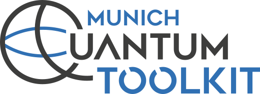

<table>
<tr>
<td width="60%">
  <a href="https://mqt.readthedocs.io">
    <picture>
      <source media="(prefers-color-scheme: dark)" srcset="https://raw.githubusercontent.com/munich-quantum-toolkit/.github/refs/heads/main/docs/_static/logo-mqt-dark.svg" width="100%">
      
    </picture>
  </a>
</td>
<td width="40%" align="right">
  
</td>
</tr>
</table>

# Connecting the Quantum and HPC Communities

A Tutorial on High-Performance Software for Quantum Computing · SC26

## Introduction

Together, we will build quantum programs, compile them for different devices,
and execute them through QDMI. Along the way, we will explore how quantum
computing fits into HPC workflows. The exercises use Qiskit and MQT Core and run
locally on simulators, so no quantum hardware account is needed.

## Setup

Choose either option below from the `tutorial/` directory. Both start JupyterLab
with Python 3.15 and the tutorial dependencies in an isolated environment. The
first run downloads Python and dependencies as needed.

### Option 1: Run uv directly

Install [uv](https://docs.astral.sh/uv/getting-started/installation/) using a
method of your choice, then run:

```sh
cd notebooks
uv run --no-project --python 3.15 --with-requirements requirements.txt jupyter lab
```

### Option 2: Use a launcher

On macOS or Linux:

```sh
bash notebooks/start.sh
```

On Windows, in PowerShell:

```powershell
powershell -NoProfile -ExecutionPolicy Bypass -File .\notebooks\start.ps1
```

The launchers install `uv` for your user if needed, then run the same command as
Option 1.

Once JupyterLab opens, start with
[Build a circuit](notebooks/circuit_basics.ipynb). See the
[notebook guide](notebooks/README.md) for the full sequence and an alternative
setup using Python's `venv` and `pip`.
